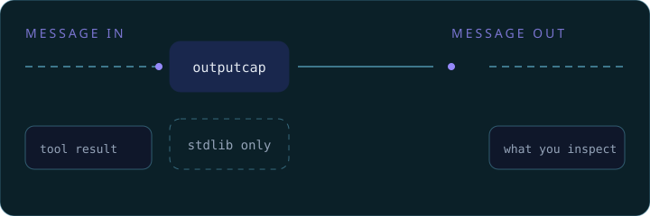

<p align="center">
  
</p>

<p align="center">
  <a href="https://pypi.org/project/outputcap/"></a>
  <a href="https://pypi.org/project/outputcap/"></a>
  <a href="https://pypi.org/project/outputcap/"></a>
  <a href="https://github.com/sandeshbagmare/outputcap/actions/workflows/ci.yml"></a>
  <a href="https://github.com/sandeshbagmare/outputcap/blob/main/LICENSE"></a>
  <a href="https://sandeshbagmare.github.io/outputcap/"></a>
  <a href="https://pypi.org/project/outputcap/"></a>
</p>

<h3 align="center">keep a huge tool result out of the context window</h3>
<p align="center"><em>Standard library only. No runtime dependencies. Python 3.9+.</em></p>

<p align="center">
  
</p>

## Install

```console
pip install outputcap
```

## Use

```python
from outputcap import cap

def read_file(path):
    text = Path(path).read_text(errors="replace")
    capped = cap(text, max_chars=4000, directory=".agent/outputs")
    return capped.message()          # bounded preview + "[output truncated: 812 kB … at …]"

def read_slice(path, start, end):    # the follow-up tool the model can call
    return cap(...).read(start, end)
```

Reading the rest back:

```python
capped.read(0, 2000)      # any slice of the full text
capped.read()             # all of it
read_handle(capped.handle)
slices(capped.read(), 2000)   # [(0, 2000), (2000, 4000), …] for a paging tool
```

```console
$ outputcap build.log                        # preview on stdout, size on stderr
$ outputcap api.json --max-chars 2000 --store .agent/outputs
$ outputcap build.log --note-only            # just the one-line summary
```

## How the budget splits

The default split is 80% head and 20% tail, so the summary at the top and the failure at
the bottom both survive. Choose it explicitly when you know better:

```python
cap(text, max_chars=2000, head=2000, tail=0)   # a JSON document: the start is what matters
cap(text, max_chars=2000, head=0, tail=2000)   # a log: only the end matters
```

The note is a single line, so a model reading the preview knows the value was cut, how big
it was, and where the rest is:

```
[output truncated: 812441 chars, showing the first 3200 and the last 799; full value at .agent/outputs/output-1a2b3c4d.txt]
```

## Rules

- Nothing is truncated below the budget; `cap` is a no-op when the value already fits.
- A dict or list becomes indented JSON, because that is what a model reads best.
- With `directory`, the full text is written once and the in-memory copy is dropped; without
  it the value stays in `capped.full` and `capped.read()` still works.
- `slices()` provides the ranges for a paging tool, with optional overlap so a match on a
  boundary is not lost.
- The budget is in **characters**, not tokens: a token count needs the model's tokenizer,
  which this library deliberately does not have.

## Limits

- No compression, no summarising, no embedding: the full value is kept verbatim and read
  back verbatim. A summary would lose exactly the detail a follow-up needs.
- A budget below 16 characters drops the tail, because a separator costs more than it
  saves.
- Files are written with a random name unless you pass `name=`; nothing cleans the
  directory up, that is your run's job.

## Development

```console
python -m venv .venv
.venv/bin/pip install -e ".[test]"
.venv/bin/pytest
```

## License

MIT.
